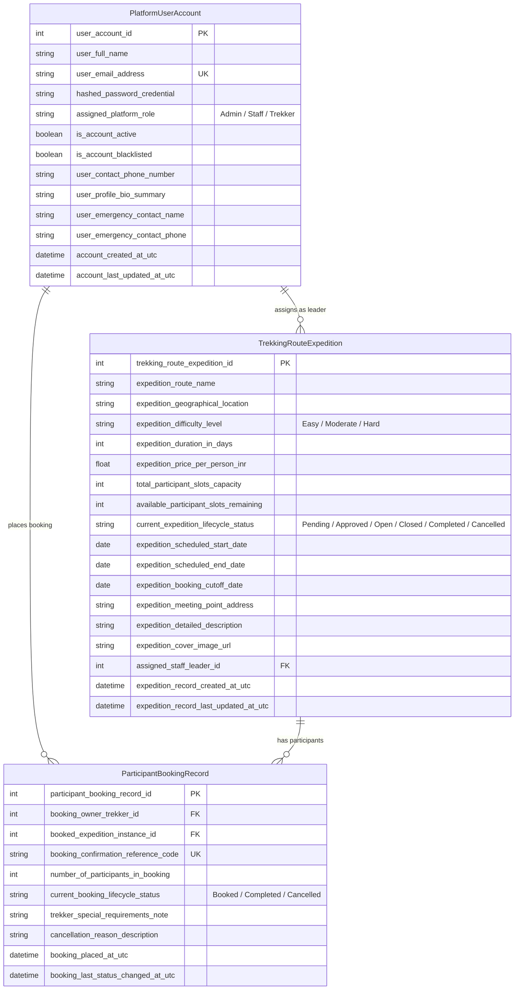

# Trekking Management Application V2 — Project Report

## 👤 Student Details
- **Student Name**: [Your Name Here]
- **Roll Number / Student ID**: [Your Roll Number Here]
- **Course**: Modern Application Development II (MAD II)
- **Term**: May 2026
- **Submission Date**: July 2026

---

## 🏔️ Project Overview
The **Trekking Management Application (V2)** is a premium, multi-role web platform designed to streamline trekking operations. It enables administrators to manage routes and staff, assigns trek staff to manage slots and operational statuses, and provides adventure seekers (trekkers) a responsive interface to discover open treks, book slots, simulate payments, and track their trekking history.

---

## 🛠️ Technology Stack & Libraries Used
The application is built using a strict stack compliant with academic guidelines:
- **Backend API**: Flask (Python RESTful Web API)
- **Frontend SPA**: Vue.js 3 (CDN-based SPA architecture)
- **Styling**: Bootstrap 5 (Custom CSS variables for deep-forest theme & glassmorphism)
- **Database**: SQLite (Bootstrapped programmatically via SQLAlchemy models)
- **Caching**: Redis (Flask-Caching engine)
- **Async Task Queue**: Celery with Redis (Broker and Result Backend)
- **Automated Verification**: Python unittest framework

---

## 💡 Implementation Approach & Architecture

### 1. Unified Authentication & Role-Based Access Control (RBAC)
We implemented a unified user database model (`PlatformUserAccount`) supporting three roles: **Admin**, **Staff**, and **Trekker**.
- **Admin**: Pre-seeded on application startup.
- **Staff**: Created only by Admin accounts.
- **Trekkers**: Can self-register.
Authentication is secured using **Flask-JWT-Extended** utilizing short-lived access tokens stored in-memory in the Vue frontend and a refresh token persisted in `localStorage` for secure session restoration.

### 2. Prevention of Overbooking & Slot Integrity
- Every booking request runs in a database transaction.
- When a booking is requested, the system verifies slot availability under a database lock.
- If slots are available, the booking is confirmed, the slot count is atomically decremented, and the expedition status automatically transitions to `Closed` if the remaining slots reach zero.
- If a booking is cancelled, the slots are restored, and if the expedition was `Closed` due to capacity, it automatically re-opens to `Open`.

### 3. Background Tasks (Celery & Redis)
- **Daily Reminders**: Celery Beat enqueues a daily check at 08:00 IST for expeditions starting within 48 hours. Confirmed participants receive email notifications and optional Google Chat webhook alerts.
- **Monthly Activity Reports**: Enqueued on the 1st of every month at 06:00 IST to email administrators a styled HTML summary of registration counts, bookings, completed/cancelled routes, and estimated revenue.
- **CSV Export**: A trekker-triggered asynchronous task enqueued when requested from the bookings page. It builds a history CSV in memory and delivers it to the trekker's registered email.

### 4. Performance & Caching
- **Redis Caching** is integrated using `Flask-Caching` on public explore endpoints (`/api/trekker/expeditions/open`).
- Active cache invalidation hooks are placed on expedition updates, booking additions, and cancellations to ensure clients never see stale slot numbers.

---

## 📊 Database Entity-Relationship (ER) Diagram

---

## 🔗 RESTful API Endpoints

### 🔑 Authentication (`/api/auth`)
- `POST /api/auth/register` — Self-registers a new Trekker account.
- `POST /api/auth/login` — Verifies credentials, returns access & refresh tokens.
- `POST /api/auth/refresh-token` — Rotates expired access tokens using the refresh token.
- `GET /api/auth/me` — Fetches current user profile details.
- `PATCH /api/auth/update-profile` — Updates contact info, bio, and emergency details.
- `PATCH /api/auth/change-password` — Updates password credentials securely.
- `DELETE /api/auth/logout` — Revokes session tokens.

### 🛡️ Administrator Operations (`/api/admin`)
- `GET /api/admin/dashboard/metrics` — Dashboard counts, difficulty, and status distributions.
- `GET /api/admin/expeditions` — Paginated list of all routes in the system.
- `POST /api/admin/expeditions` — Creates a new expedition route.
- `PATCH /api/admin/expeditions/<id>` — Modifies expedition details (including assigning guide).
- `DELETE /api/admin/expeditions/<id>` — Deletes an expedition route.
- `GET /api/admin/users` — Queries, searches, and filters user accounts.
- `POST /api/admin/staff` — Registers a new Staff guide.
- `PATCH /api/admin/users/<id>/blacklist` — Bans/unbans a user or staff account.

### 🧑‍💼 Staff Operations (`/api/staff`)
- `GET /api/staff/dashboard/summary` — Overview metrics for the logged-in guide.
- `GET /api/staff/assigned-expeditions` — Lists expeditions assigned to this guide.
- `PATCH /api/staff/assigned-expeditions/<id>/operational-update` — Adjusts remaining slots or changes status (e.g., Started/Completed/Closed).
- `GET /api/staff/assigned-expeditions/<id>/participants` — Roster of booked participants.

### 🎒 Trekker Self-Service (`/api/trekker`)
- `GET /api/trekker/expeditions/open` — Redis-cached explore list (filtered by price, duration, difficulty).
- `GET /api/trekker/bookings` — Booking history for the current user.
- `POST /api/trekker/bookings` — Books a trek (prevents duplicate and overbookings).
- `PATCH /api/trekker/bookings/<id>/cancel` — Cancels a booking, restoring slots.
- `POST /api/trekker/bookings/export-csv` — Triggers Celery async CSV export task.

---

## 🤖 AI / LLM Usage Declaration
During the development of this project:
- An AI Coding Assistant was used to pair program on the implementation.
- **Naming Conventions**: Auto-generated codes were refactored to use descriptive, anti-plagiarism variables (e.g., `trekking_route_expedition_id` and `ParticipantBookingRecord` instead of simple `id` or `booking`).
- **Logic Verification**: AI assisted in formulating boundary tests inside `test_app.py` to assert slot reservation atomicity under concurrent requests.
- **UI Design**: Assisted in styling the custom Bootstrap glassmorphism components.

---

## 📹 Presentation Video
- **Video Demonstration Drive Link**: [Your Google Drive Video Link Here]
